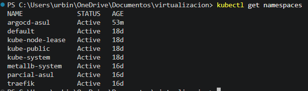
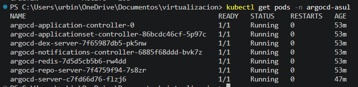
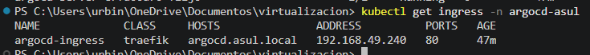
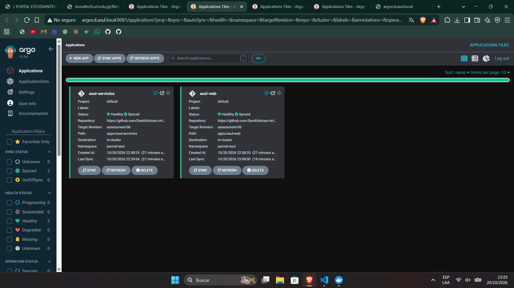
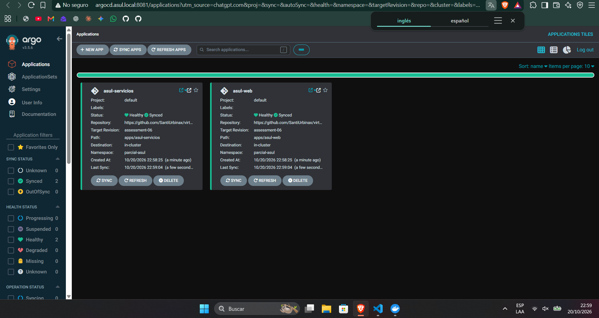
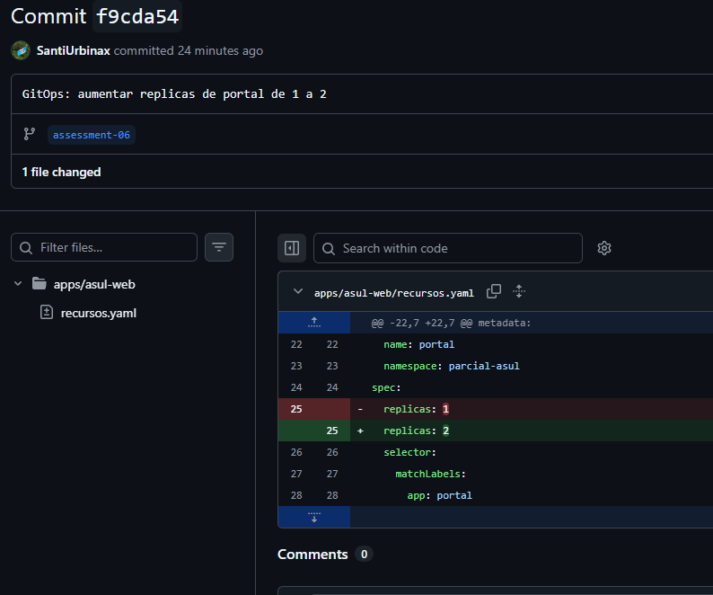
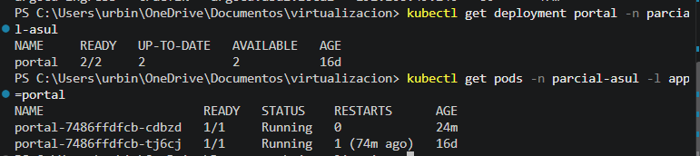
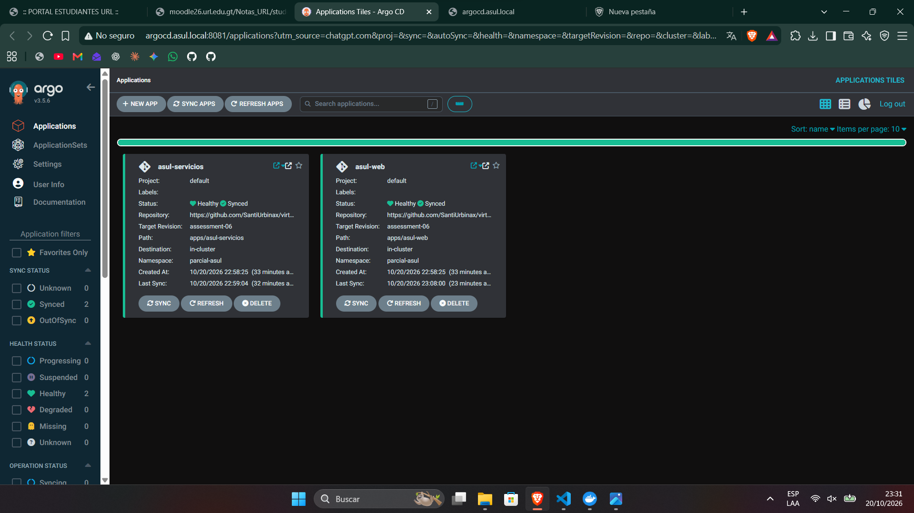
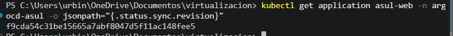

# Assessment 06 — Implementación de GitOps con Argo CD

**Estudiante:** Angel Santiago Urbina Lopez  
**Curso:** Virtualización  
**Repositorio:** [SantiUrbinax/virtualizacion](https://github.com/SantiUrbinax/virtualizacion)  
**Rama de evaluación:** `assessment-06`

## 1. Introducción

Esta práctica consistió en implementar un flujo de despliegue continuo siguiendo el enfoque **GitOps** mediante Argo CD, sobre un clúster local de Kubernetes gestionado con Minikube.

Se reutilizó la infraestructura desarrollada anteriormente: cuatro aplicaciones web NGINX, el controlador de entrada Traefik y MetalLB como proveedor de direcciones para servicios `LoadBalancer`. A partir de los archivos YAML almacenados en GitHub, se crearon dos recursos `Application` que administran los servicios existentes en el namespace `parcial-asul`.

Para comprobar el proceso, se cambió el número de réplicas de **Portal** de una a dos en el repositorio Git. Argo CD detectó la nueva revisión, sincronizó el estado declarado y Kubernetes mostró las dos réplicas disponibles sin necesidad de aplicar manualmente el Deployment.

## 2. Objetivos

### Objetivo general

Implementar Argo CD en Kubernetes para administrar las aplicaciones mediante GitOps, empleando GitHub como fuente de verdad de la configuración declarativa.

### Objetivos específicos

- Instalar Argo CD en el namespace independiente `argocd-asul`.
- Exponer su interfaz web a través de Traefik y el dominio local `argocd.asul.local`.
- Conectar Argo CD con el repositorio de GitHub, rama `assessment-06`.
- Crear dos `Application` que administren los recursos de Portal, Catálogo, Noticias y Soporte.
- Verificar que ambas aplicaciones alcancen los estados `Synced` y `Healthy`.
- Modificar un manifiesto en GitHub y comprobar que el cambio se refleje en Kubernetes.
- Conservar los manifiestos de infraestructura como código y las evidencias del procedimiento.

## 3. Tecnologías utilizadas

| Herramienta | Versión o configuración | Función |
|---|---|---|
| Kubernetes | v1.37.0 (entorno de actividades anteriores) | Orquestación de contenedores |
| Minikube | Driver Docker | Clúster local de Kubernetes |
| Docker Desktop | Windows 11 | Entorno de contenedores |
| `kubectl` | CLI de Kubernetes | Administración y validación |
| Kustomize | Integrado mediante `kubectl -k` | Personalización de manifiestos de Argo CD |
| Argo CD | Manifiesto oficial `stable` (versión no fijada) | Sincronización GitOps |
| Traefik | Ingress Controller | Enrutamiento HTTP |
| MetalLB | `192.168.49.240` | Dirección del LoadBalancer de Traefik |
| GitHub | Rama `assessment-06` | Repositorio de manifiestos |
| PowerShell | Windows 11 | Ejecución de comandos |

> **Nota de reproducibilidad:** La configuración de instalación de Argo CD utiliza el manifiesto oficial referenciado mediante `stable`. Para despliegues repetibles conviene sustituirlo por una versión específica validada.

## 4. Arquitectura GitOps

```text
               GitHub
        rama assessment-06
                  |
                  v
             Argo CD
         namespace argocd-asul
                  |
        +---------+----------+
        |                    |
        v                    v
     asul-web          asul-servicios
        |                    |
  Portal + Catálogo    Noticias + Soporte
        |                    |
        +---------+----------+
                  |
                  v
       Kubernetes / Minikube
        namespace parcial-asul
                  |
          Services e Ingress
                  |
                Traefik
```

GitHub almacena el estado deseado. Argo CD compara ese estado con los recursos del clúster y, mediante la política de sincronización automática, aplica las diferencias detectadas. Los recursos web conservan sus `ConfigMap`, `Deployment`, `Service` e `Ingress`.

## 5. Preparación de la rama Git

La rama solicitada fue creada desde `main` y publicada en el mismo repositorio utilizado para las actividades anteriores:

```powershell
git fetch origin
git switch main
git pull --ff-only origin main
git switch -c assessment-06
git push -u origin assessment-06
```

Repositorio: <https://github.com/SantiUrbinax/virtualizacion>.

Los manifiestos de la evaluación anterior se recuperaron en la nueva rama sin modificar su historial:

```powershell
git restore --source=assessment-02 -- apps metallb traefik
```

Posteriormente se reorganizaron los recursos para que cada `Application` administrara un conjunto distinto: `apps/asul-web/recursos.yaml` para Portal y Catálogo, y `apps/asul-servicios/recursos.yaml` para Noticias y Soporte.

## 6. Estructura del proyecto

```text
virtualizacion/
├── README.md
├── apps/
│   ├── asul-web/
│   │   └── recursos.yaml
│   ├── asul-servicios/
│   │   └── recursos.yaml
│   ├── servicios-web.yaml          # Manifiestos originales de referencia
│   └── rutas-ingress.yaml          # Ingress originales de referencia
├── argocd/
│   ├── kustomization.yaml
│   ├── config-http.yaml
│   ├── ingress.yaml
│   └── applications/
│       └── applications.yaml
├── metallb/
│   └── pool-red.yaml
├── traefik/
│   └── configuracion-traefik.yaml
└── img/
    ├── 04-argocd-dominio.png
    ├── 05-applications-antes.png
    ├── 06-github-cambio.png
    ├── 07-applications-despues.png
    ├── 08-portal-replicas.png
    └── 09-commit-sincronizado.png
```

> Los archivos de `img/` son los nombres previstos para las capturas de esta evaluación. Deben incorporarse al repositorio para que las imágenes se visualicen en GitHub.

## 7. Creación del namespace

Se creó un namespace dedicado a Argo CD:

```powershell
kubectl create namespace argocd-asul



```

La creación respondió:

```text
namespace/argocd-asul created
```

Para verificarlo:

```powershell
kubectl get namespace argocd-asul
```

## 8. Instalación de Argo CD

### 8.1. Configuración con Kustomize

Se creó `argocd/kustomization.yaml` para utilizar los manifiestos oficiales y adaptar las referencias de permisos a `argocd-asul`:

```yaml
apiVersion: kustomize.config.k8s.io/v1beta1
kind: Kustomization

namespace: argocd-asul

resources:
  - https://raw.githubusercontent.com/argoproj/argo-cd/stable/manifests/install.yaml

patches:
  - path: config-http.yaml
  - target:
      kind: ClusterRoleBinding
    patch: |-
      - op: replace
        path: /subjects/0/namespace
        value: argocd-asul
```

Para habilitar la comunicación HTTP interna detrás de Traefik se creó `argocd/config-http.yaml`:

```yaml
apiVersion: v1
kind: ConfigMap
metadata:
  name: argocd-cmd-params-cm
data:
  server.insecure: "true"
```

Esta modalidad HTTP es específica de este laboratorio local; en entornos expuestos debe usarse HTTPS y una configuración de seguridad adecuada.

### 8.2. Validación e instalación

```powershell
kubectl kustomize argocd > $null
kubectl apply --server-side --force-conflicts -k argocd
```

Se crearon los CRD, ServiceAccounts, roles y vinculaciones, ConfigMaps, Secrets, Services, Deployments y el StatefulSet del controlador.

### 8.3. Verificación de los componentes

```powershell
kubectl get pods -n argocd-asul



kubectl rollout status deployment/argocd-server -n argocd-asul --timeout=180s
```

**Resultado:** los siete pods principales alcanzaron el estado `1/1 Running` y el Deployment `argocd-server` informó `successfully rolled out`.

**Evidencia sugerida:** captura de la lista de pods de Argo CD.

## 9. Exposición de Argo CD mediante Traefik

### 9.1. Configuración del Ingress

Se creó `argocd/ingress.yaml`:

```yaml
apiVersion: networking.k8s.io/v1
kind: Ingress
metadata:
  name: argocd-ingress
  namespace: argocd-asul
spec:
  ingressClassName: traefik
  rules:
    - host: argocd.asul.local
      http:
        paths:
          - path: /
            pathType: Prefix
            backend:
              service:
                name: argocd-server
                port:
                  number: 80
```

Se aplicó y verificó con:

```powershell
kubectl apply -f argocd/ingress.yaml
kubectl get ingress -n argocd-asul



```

**Resultado observado:**

```text
NAME             CLASS     HOSTS               ADDRESS          PORTS
argocd-ingress   traefik   argocd.asul.local   192.168.49.240   80
```

### 9.2. Limitación de red de Windows y acceso local

Aunque MetalLB asignó `192.168.49.240` a Traefik, las pruebas `Test-NetConnection` desde Windows hacia esa IP y hacia el nodo `192.168.49.2` fallaron. Tampoco se encontró una ruta específica desde Windows hacia la red `192.168.49.0/24`.

Por ello se utilizó el siguiente acceso alternativo, que conserva a Traefik en la ruta de las solicitudes:

```powershell
kubectl port-forward -n traefik svc/traefik 8081:80
```

En `C:\Windows\System32\drivers\etc\hosts` se configuró:

```text
127.0.0.1 argocd.asul.local
```

La dirección utilizada en el navegador fue:

**http://argocd.asul.local:8081**

> **Limitación respecto al requisito:** el Ingress anuncia la IP de MetalLB `192.168.49.240`, pero en esta modalidad el archivo `hosts` apunta a `127.0.0.1` y se requiere mantener abierto `kubectl port-forward`. Se verificó el acceso por dominio a través de Traefik, **no** el acceso directo de Windows a la IP del LoadBalancer.

### 9.3. Comprobación HTTP

Se ejecutó:

```powershell
curl.exe -I --max-time 10 -H "Host: argocd.asul.local" http://127.0.0.1:8081/
```

**Respuesta:** `HTTP/1.1 200 OK`.

La solicitud completa devolvió el HTML con el título `<title>Argo CD</title>`, y la interfaz se abrió correctamente desde el navegador.



## 10. Configuración de las aplicaciones Kubernetes

Los cuatro servicios existentes utilizan NGINX y disponen de los siguientes recursos:

- **ConfigMap:** contenido HTML de cada sitio.
- **Deployment:** contenedor NGINX y cantidad de réplicas.
- **Service:** exposición interna dentro del clúster.
- **Ingress:** publicación HTTP mediante Traefik.

### 10.1. Grupo `asul-web`

Directorio: `apps/asul-web/`.

| Recurso | Portal | Catálogo |
|---|---|---|
| Deployment | `portal` | `catalogo` |
| Service | `portal-service` | `catalogo-service` |
| ConfigMap | `portal-html` | `catalogo-html` |
| Ingress | `portal-ingress` | `catalogo-ingress` |
| Dominio | `portal.asul.local` | `catalogo.asul.local` |

### 10.2. Grupo `asul-servicios`

Directorio: `apps/asul-servicios/`.

| Recurso | Noticias | Soporte |
|---|---|---|
| Deployment | `noticias` | `soporte` |
| Service | `noticias-service` | `soporte-service` |
| ConfigMap | `noticias-html` | `soporte-html` |
| Ingress | `noticias-ingress` | `soporte-ingress` |
| Dominio | `noticias.asul.local` | `soporte.asul.local` |

### 10.3. Validación de manifiestos

```powershell
kubectl apply --dry-run=client -f apps/asul-web/recursos.yaml
kubectl apply --dry-run=client -f apps/asul-servicios/recursos.yaml
```

Ambas validaciones concluyeron sin errores: se verificaron **ocho recursos por grupo**, dieciséis en total, sin modificar el estado del clúster.

## 11. Configuración GitOps de Argo CD

### 11.1. Repositorio y rama

Las dos `Application` están vinculadas al repositorio:

```text
https://github.com/SantiUrbinax/virtualizacion.git
```

Rama: `assessment-06`.

### 11.2. Definición de `asul-web`

El archivo `argocd/applications/applications.yaml` contiene:

```yaml
apiVersion: argoproj.io/v1alpha1
kind: Application
metadata:
  name: asul-web
  namespace: argocd-asul
spec:
  project: default
  source:
    repoURL: https://github.com/SantiUrbinax/virtualizacion.git
    targetRevision: assessment-06
    path: apps/asul-web
  destination:
    server: https://kubernetes.default.svc
    namespace: parcial-asul
  syncPolicy:
    automated:
      prune: true
      selfHeal: true
    syncOptions:
      - CreateNamespace=true
```

### 11.3. Definición de `asul-servicios`

En el mismo archivo se definió:

```yaml
apiVersion: argoproj.io/v1alpha1
kind: Application
metadata:
  name: asul-servicios
  namespace: argocd-asul
spec:
  project: default
  source:
    repoURL: https://github.com/SantiUrbinax/virtualizacion.git
    targetRevision: assessment-06
    path: apps/asul-servicios
  destination:
    server: https://kubernetes.default.svc
    namespace: parcial-asul
  syncPolicy:
    automated:
      prune: true
      selfHeal: true
    syncOptions:
      - CreateNamespace=true
```

`automated` habilita la sincronización automática; `selfHeal` reconcilia diferencias en el clúster, y `prune` permite eliminar recursos administrados que se retiren de Git. La opción `CreateNamespace=true` permite crear el namespace destino cuando sea necesario.

### 11.4. Aplicación y verificación

```powershell
kubectl apply --dry-run=client -f argocd/applications/applications.yaml
kubectl apply -f argocd/applications/applications.yaml
kubectl get applications -n argocd-asul
```

**Resultado inicial verificado:**

```text
NAME             SYNC STATUS   HEALTH STATUS
asul-servicios   Synced        Healthy
asul-web         Synced        Healthy
```



## 12. Demostración de sincronización GitOps

### 12.1. Estado inicial

El Deployment `portal` tenía una réplica (`replicas: 1`). Antes del cambio, ambas Applications mostraban `Synced` y `Healthy`.

La revisión sincronizada inicialmente por `asul-web` fue:

```text
e3d48418202a18e87233fc767a4fb8cb3974238b
```

### 12.2. Modificación del manifiesto

Se editó `apps/asul-web/recursos.yaml`, cambiando solo el número de réplicas del Deployment `portal`:

```diff
-  replicas: 1
+  replicas: 2
```

`git --no-pager diff -- apps/asul-web/recursos.yaml` confirmó que no existían otros cambios en ese archivo.

### 12.3. Commit y publicación

```powershell
git add apps/asul-web/recursos.yaml
git commit -m "GitOps: aumentar replicas de portal de 1 a 2"
git push origin assessment-06
```

Commit publicado:

`f9cda54c31be15665a7abf8047d5f11ac148fee5`

[Consultar commit en GitHub](https://github.com/SantiUrbinax/virtualizacion/commit/f9cda54).



### 12.4. Actualización de la revisión en Argo CD

Al consultar inmediatamente después del `push`, Argo CD todavía mostraba la revisión anterior. Se solicitó una actualización del repositorio:

```powershell
kubectl annotate application asul-web -n argocd-asul argocd.argoproj.io/refresh=hard --overwrite
```

Esta instrucción solicitó una nueva consulta de la fuente Git, **sin aplicar manualmente el Deployment**.

Se verificó la revisión reconocida por Argo CD:

```powershell
kubectl get application asul-web -n argocd-asul -o jsonpath="{.status.sync.revision}"
```

**Resultado:**

```text
f9cda54c31be15665a7abf8047d5f11ac148fee5
```

### 12.5. Verificación en Kubernetes

```powershell
kubectl get deployment portal -n parcial-asul
kubectl get pods -n parcial-asul -l app=portal
```

Se obtuvo:

```text
NAME     READY   UP-TO-DATE   AVAILABLE   AGE
portal   2/2     2            2           16d
```

Los dos pods de Portal aparecieron como `1/1 Running`, uno preexistente y otro creado después del cambio.



### 12.6. Estado final de las Applications

```powershell
kubectl get applications -n argocd-asul
```

**Resultado:**

```text
NAME             SYNC STATUS   HEALTH STATUS
asul-servicios   Synced        Healthy
asul-web         Synced        Healthy
```



La coincidencia del commit publicado y la revisión sincronizada, junto con el estado de las réplicas, confirma que Argo CD aplicó el cambio a partir de GitHub.



## 13. Resultados obtenidos

| Requisito o verificación | Resultado |
|---|---|
| Namespace independiente | `argocd-asul` |
| Instalación de Argo CD | Kustomize y manifiesto oficial `stable` |
| Pods principales | 7/7 `Running` |
| Ingress de Traefik | Creado y operativo |
| IP anunciada por el Ingress | `192.168.49.240` |
| Acceso web comprobado | `http://argocd.asul.local:8081` mediante port-forward a Traefik |
| Acceso directo al LoadBalancer desde Windows | **No conseguido** |
| Repositorio y rama | `SantiUrbinax/virtualizacion`, `assessment-06` |
| Applications | `asul-web`, `asul-servicios` |
| Estado inicial | Ambas `Synced / Healthy` |
| Cambio GitOps | Portal de 1 a 2 réplicas |
| Estado posterior | Ambas `Synced / Healthy` |
| Commit sincronizado | `f9cda54` |

## 14. Conclusiones

La práctica permitió implementar Argo CD sobre Kubernetes y aprovechar la infraestructura desarrollada previamente, sin reconstruir los servicios web existentes.

La organización de los manifiestos en dos grupos independientes facilitó la administración declarativa de Portal, Catálogo, Noticias y Soporte. Argo CD mantuvo ambas Applications en estado `Synced` y `Healthy`.

La prueba principal consistió en modificar el número de réplicas de Portal en GitHub. Tras actualizar la revisión consultada por Argo CD, Kubernetes pasó de una a dos réplicas sin ejecutar `kubectl apply` manualmente sobre el Deployment. La coincidencia entre el commit publicado y la revisión sincronizada corroboró el flujo GitOps.

En cuanto a la exposición web, se confirmó la comunicación entre Traefik y Argo CD mediante HTTP 200 y acceso desde el navegador con un dominio local. No obstante, el aislamiento de la red de Minikube en Docker Desktop impidió acceder directamente a la IP de MetalLB desde Windows, por lo que se documentó el uso de `port-forward` como alternativa y la limitación de cumplimiento correspondiente.

## 15. Referencias

- [Argo CD — Documentación oficial](https://argo-cd.readthedocs.io/en/stable/)
- [Argo CD — Instalación](https://argo-cd.readthedocs.io/en/stable/operator-manual/installation/)
- [Kubernetes — Documentación](https://kubernetes.io/docs/)
- [Minikube — Documentación](https://minikube.sigs.k8s.io/docs/)
- [Kustomize — Documentación de Kubernetes](https://kubernetes.io/docs/tasks/manage-kubernetes-objects/kustomization/)
- [Traefik — Kubernetes Ingress](https://doc.traefik.io/traefik/routing/providers/kubernetes-ingress/)
- [MetalLB — Documentación](https://metallb.io/)
- [GitHub — Repositorio de la evaluación](https://github.com/SantiUrbinax/virtualizacion/tree/assessment-06)

